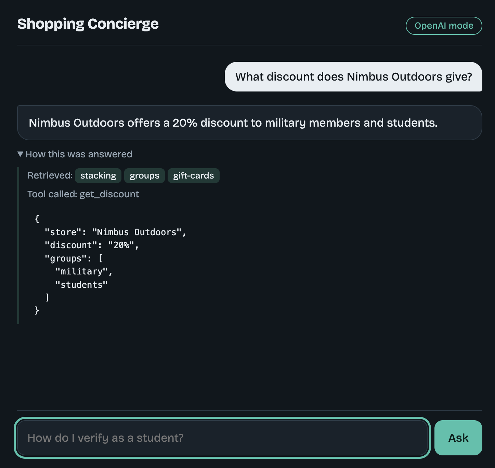

# Shopping Concierge

A small RAG question-answering API with LLM tool-calling, built with FastAPI. It answers member questions (verification, discounts, shipping, returns) using a small knowledge base and can look up store discounts through a tool.



**Works with or without an API key.**

| Mode | When | Retrieval | Answering |
|------|------|-----------|-----------|
| `openai` | `OPENAI_API_KEY` is set | OpenAI embeddings (`text-embedding-3-small`) | `gpt-4o-mini` with function/tool-calling |
| `demo` | no key | TF-IDF (scikit-learn) | top retrieved passage + keyword-triggered tool call |

The response includes a `mode` field so you always know which path ran.

## Run it

```bash
python -m venv .venv && source .venv/bin/activate
pip install -r requirements.txt
# optional: add a key for OpenAI mode (copy .env.example to .env and fill it in)
python -m uvicorn app:app --reload
```

```bash
curl -X POST localhost:8000/ask -H "Content-Type: application/json" \
  -d '{"question": "How do I verify as a student?"}'
```

```json
{"answer": "...", "sources": ["student-docs", "verify-how", "groups"], "tools_used": [], "mode": "demo"}
```

Open `http://localhost:8000` for the chat demo page (it shows the retrieved documents and any tool call under each answer). API docs are at `http://localhost:8000/docs`.

## How it works

1. **Embed once:** the ~15 documents in `docs.json` are embedded at startup and kept in memory as a matrix of unit vectors. No vector database is needed at this scale.
2. **Retrieve:** the question is embedded and scored against every document with cosine similarity (a single matrix-vector product). The top 3 are returned.
3. **Generate:** in `openai` mode the retrieved passages go into a prompt that restricts the model to the given context and tells it to say "I don't know" otherwise.
4. **Tool-calling:** the model can call `get_discount(store)` or `find_stores(group)` to look up structured data instead of guessing, and it chooses which tool fits the question. The loop handles multiple tool rounds.

## Evaluation

`python eval.py` runs 12 test questions: retrieval checks (is the right document in the top 3?), a tool-call check, and out-of-scope questions that should be refused.

Known limitation: demo mode uses keyword matching, so paraphrases with no word overlap can miss. OpenAI mode handles these better because embeddings capture meaning. Refusal in demo mode is a simple score threshold; in OpenAI mode it relies on the prompt.

## Sample responses

`samples_demo.md` and `samples_openai.md` hold recorded answers to the same 10 questions in each mode, including paraphrases and out-of-scope questions. Regenerate them with `python record_samples.py` (set `OPENAI_API_KEY` for the OpenAI version).

## Project structure

| File | Purpose |
|------|---------|
| `app.py` | FastAPI app: retrieval, tools, both answering modes |
| `docs.json` | The small knowledge base (fictional help-center articles) |
| `static/index.html` | One-page demo UI |
| `eval.py` | 12-question check for retrieval, tool use, and refusals |
| `record_samples.py` | Saves answers to `samples_<mode>.md` |

## Design notes

- Brute-force search is fine for ~15 documents. A vector DB (Chroma, pgvector) would make sense once the corpus grows past a few thousand.
- The knowledge base and stores are fictional.
